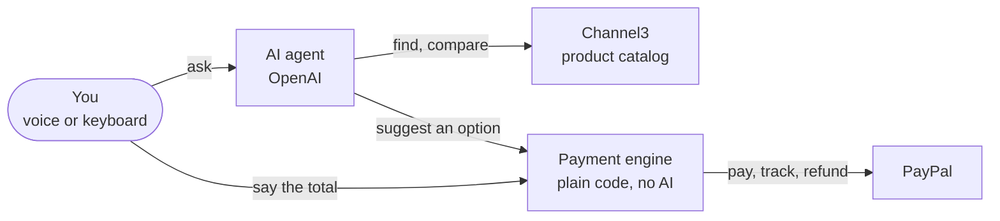

<div align="center">


# SayStreet

**Accessible online shopping for blind and low-vision people.**

Find, compare, buy, track and return in one conversation. Nothing is paid until you say the exact total.

**[Try the live demo](https://demo.saystreet.app)** · [Run your own](#run-it-yourself) · [Landing page](https://saystreet.app)

[](https://demo.saystreet.app)
[](https://paypalaihackathon.devpost.com/)
[](https://github.com/saystreet/demo/actions/workflows/ci.yml)
[](LICENSE)

</div>

The live demo needs no sign-up, keys or install. It runs on the PayPal sandbox: no real money moves and nothing ships.

## Why

A screen reader announces a button without a label as just "button". Is it Pay or Cancel? On a checkout page, that's a question about your money.

About 7 million people in the US have vision loss that glasses can't correct, and more than 700,000 of them are blind ([CDC](https://www.cdc.gov/vision-health-data/prevalence-estimates/vision-loss-prevalence.html)). The web keeps failing them: in February 2026, 95.9% of the top million home pages had accessibility errors that an automated scan can find. Half had form fields without labels, and almost a third had buttons with no name ([WebAIM Million](https://webaim.org/projects/million/)). Screen reader users rank CAPTCHA as the most problematic thing on the web ([WebAIM, 2024](https://webaim.org/projects/screenreadersurvey10/)).

They already turn to AI to get around it: in WebAIM's 2026 survey, 91.8% of screen reader users said they use AI to improve their experience online, and 40.6% use it for guidance with an online task ([WebAIM](https://webaim.org/projects/screenreadersurvey11/)). Shopping is heading the same way for everyone: Morgan Stanley estimates that AI shopping agents could account for $190–385 billion of US e-commerce spending by 2030, 10–20% of online retail ([Morgan Stanley](https://www.morganstanley.com/insights/articles/agentic-commerce-market-impact-outlook)). If those agents are built only for sighted shoppers, the same people get left out again.

## What SayStreet changes

- **One conversation, every step.** Search more than 100 million products, hear three options at a time, ask anything about them, buy, then track or return the order in the same chat.
- **Your words move the money, not the AI.** The agent can only suggest a purchase. It's paid when you say the exact total; "yes" never pays.
- **Nothing to fight with.** No CAPTCHA, no payment pop-up, and any time limit can be stretched by saying "more time". It works with VoiceOver, NVDA and the keyboard, or reads replies aloud itself.
- **PayPal behind every step.** A wallet saved once with PayPal pays without leaving the conversation, and tracking numbers and refunds go through PayPal too.

## Try it in two minutes

1. Open [demo.saystreet.app](https://demo.saystreet.app). You pay with a shared sandbox buyer, so there's nothing to log in to. Choose who reads the replies: your screen reader, or SayStreet's voice.
2. Hold **Talk** (or the Space bar) and say, or type: **"Find a whistling kettle under 40 dollars."**
3. Ask about the options: **"How much is the second one?"**, **"Which one has better reviews?"**, **"Does the first one work on induction?"**
4. **"Buy option one."** SayStreet reads the total, the shipping and the address.
5. Say **"Pay thirty-four ninety-nine"**, or press **Pay $34.99 with PayPal**. The receipt shows what PayPal answered.
6. Then: **"Where is it?"**, **"How much have I spent this week?"**, **"Return my French press."** The demo account comes with four sample orders for this.

Also try "more", "the blue one", "size ten and a half", "buy it again", or paste a product link from a store.

## How it works



The agent finds and explains products, and can only suggest a purchase. The payment engine pays, and only after the person says the exact total; it runs no AI.

| Service | What SayStreet uses it for | Code |
|---|---|---|
| **PayPal** | Saves the wallet once, pays by voice without a pop-up, adds tracking numbers, refunds returns | [`paypal/`](packages/backend/src/paypal) |
| **Channel3** (sponsor) | The catalog: search across more than 100 million products, product details, the live price right before paying, buying from a pasted link | [`catalog/`](packages/backend/src/catalog) |
| **Render** (sponsor) | Hosts the live demo and its Postgres database; one-click deploy of your own copy | [`render.yaml`](render.yaml) |
| **OpenAI** | The agent that searches, answers and suggests (`gpt-6-luna`), and speech to text (`gpt-transcribe`) | [`agent/`](packages/backend/src/agent), [`speech/`](packages/backend/src/speech) |

### PayPal

All calls go to the PayPal sandbox REST API from the backend ([`packages/backend/src/paypal`](packages/backend/src/paypal)):

| What | API |
|---|---|
| Save a PayPal wallet once: the shared demo buyer, or the person's own sandbox account | Vault v3: `POST /v3/vault/setup-tokens`, `POST /v3/vault/payment-tokens` |
| Pay with the saved wallet, with no pop-up or redirect | Orders v2: `POST /v2/checkout/orders` with `payment_source.paypal.vault_id`, then `/capture` |
| Ship with a tracking number | Orders v2: `POST /v2/checkout/orders/{id}/track` |
| Return | Payments v2: `POST /v2/payments/captures/{id}/refund` |
| Settle pending payments and refunds | Webhooks: `POST /v1/notifications/verify-webhook-signature`, then `PAYMENT.CAPTURE.*` events |

The vault is what makes paying by voice possible: the wallet is connected ahead of time, so paying never leaves the conversation. Anyone can connect their own PayPal sandbox account from the welcome dialog or Settings, and SayStreet then ships to its name and address. A sandbox buyer login for this is in the Devpost submission's additional info.

To see PayPal at work, open an order and look under **At PayPal**: every call SayStreet made for it and every verified webhook, with the HTTP status, PayPal's ids, the PayPal-Request-Id and the time it took. The receipt in the chat and the payment log in Settings show the same.

### How paying stays safe

The language model never moves money and never states an amount.

1. **The price comes from the catalog**, never from the model. The model can only propose an option by its number.
2. **The person confirms the exact total**, by saying it or with a button that names it. "Yes" is never enough, and plain code refuses negations ("I don't want to pay…").
3. **The price is checked with the store again right before paying.** If it changed, nothing is paid and the person hears the new price.
4. **Limits per purchase and per week** are checked inside a database lock, so two tabs or a double tap can't pay twice.
5. **PayPal calls are idempotent:** the purchase id is the PayPal-Request-Id. A timeout leaves the payment pending until PayPal's webhook settles it; it's never retried as a new charge.
6. **Every amount the person hears comes from a server template.** Model text that names money is dropped before it's spoken.

### AI

- **Agent:** OpenAI Responses API with function calling (`gpt-6-luna`). It searches, answers from the product listing, compares, proposes purchases and handles orders through tools. Each turn it gets a fresh picture of the chat from the database, so "the second one" always means the right product.
- **Speech to text:** OpenAI `gpt-transcribe`. Replies are read by the person's screen reader or the browser's own voice, so there's no paid text-to-speech.
- **No model where it isn't needed:** paying, cancelling, "repeat", "more" and "more time" run as plain code.

### Channel3

SayStreet uses [Channel3](https://channel3.ai)'s `POST /v1/search` to find products, `GET /v1/products/{id}` to answer questions and check the live price before paying, `POST /v1/lookup` to buy from a pasted link, and `GET /v1/websites/search` to turn "from Target" into a store filter.

Results are made for listening: one option per model with its best offer (the brand's own store first, then a known retailer, then the lowest price), no accessories unless asked for, three at a time. If Channel3 is unreachable, search falls back to recorded results, so the demo keeps working.

### Accessibility

Built for VoiceOver, NVDA and the keyboard first: one heading per page that takes focus on navigation, one polite live region, 48 px targets, text contrast of at least 7:1, forced-colors support, no timers without "more time", and no CAPTCHA anywhere.

## Limits and what's next

The demo runs on the PayPal sandbox with US addresses and US dollars, one item per purchase, in English. Shipping is a flat $5.00 and delivery is simulated. Hourly and daily limits protect the shared sandbox.

Next: live PayPal with the person's real account; other countries and currencies, since Channel3 already covers 20 markets ("pay thirty-one euros"); several items in one order.

## Run it yourself

You don't have to: the live demo is this code. To run your own copy you need a PayPal sandbox app, a Channel3 key and an OpenAI key.

[](https://render.com/deploy?repo=https://github.com/saystreet/demo)

**On Render:** the button reads [`render.yaml`](render.yaml), creates the web service and its Postgres database, and asks for the keys. Then connect the sandbox buyer (below) and add `DEMO_VAULT_ID` under the service's Environment.

**On your machine** with Docker, served at [localhost:8080](http://localhost:8080):

```bash
git clone https://github.com/saystreet/demo.git && cd demo
cp .env.example .env    # each variable says where to get it
docker compose --profile app up --build
```

For development with live reload (Node 26, pnpm, at [localhost:5173](http://localhost:5173)):

```bash
pnpm install
pnpm db:up    # Postgres only, in Docker
pnpm --filter @saystreet/backend exec prisma migrate deploy
pnpm dev
```

**Connect the sandbox buyer** once, so new accounts can pay without a PayPal login: open `/admin/vault?key=<ADMIN_TOKEN>` on your server, press "Connect sandbox buyer", log in with a sandbox **personal** account, then put the `DEMO_VAULT_ID` it shows into `.env` (or Render's Environment) and restart. Until then everything else works, and an account that connects its own PayPal sandbox account can already pay.

**Checks:** `pnpm test` (amount parsing, ranking, variants, the money guard, return rules) and `pnpm typecheck` run in CI on every push. `pnpm --filter @saystreet/backend smoke [url]` runs a real sandbox payment, shipping, a refund, a price change and account isolation against a running server.

| Path | What |
|---|---|
| [`packages/backend`](packages/backend) | Hono API, Prisma and Postgres, the agent, the payment engine, PayPal and Channel3 clients |
| [`packages/frontend`](packages/frontend) | React 19 web app: Vite, React Router, TanStack Query, Tailwind |
| [`packages/shared`](packages/shared) | Types and money helpers used by both |
| [`docs/api.md`](docs/api.md) | The API contract between frontend and backend |

## How we built it

SayStreet was built for the [PayPal AI Hackathon](https://paypalaihackathon.devpost.com/), starting from an empty repository; the commit history is the full record. The live demo runs on [Render](https://render.com) from the same [`render.yaml`](render.yaml); the landing page has [its own repository](https://github.com/saystreet/website).

We wrote the code with Claude Code and sponsors' own agent skills: Channel3's [`channel3-api`](https://github.com/channel3-ai/skills) for the catalog and Render's [`render-deploy`](https://github.com/render-oss/skills) for the deployment, along with skills for accessibility, Hono, Prisma and Vite. They're pinned in [`skills-lock.json`](skills-lock.json).

## License

[MIT](LICENSE)
